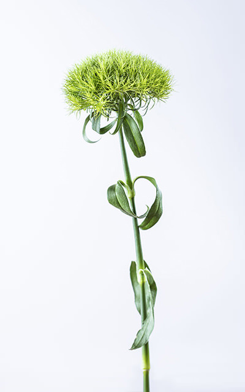
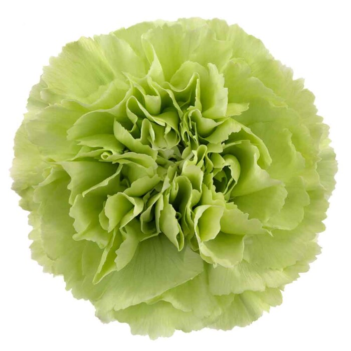
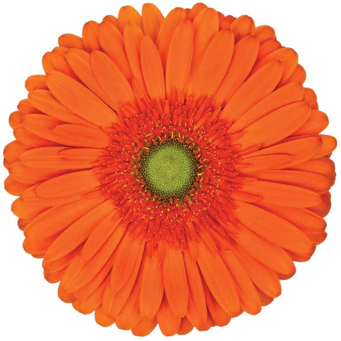
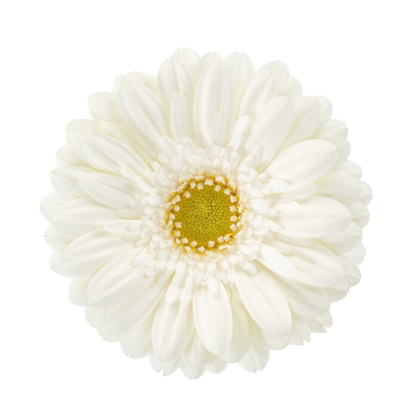

# 第一批真实花材图片候选

日期：2026-10-14。7 张图片、4 个产品。均已打开检查，保留下载原始字节；用于本地整理，尚未作为图鉴正式封面。来源、尺寸、校验值和逐图意见保存在 [candidates.json](candidates.json)。

## P014 绿毛球

来源：[Ball SB Green Ball](https://www.ballsb.com/en/variety/208-dianthus-green-ball-en)。

| 图片 | 尺寸 | 检查结果 |
| --- | --- | --- |
| [全景](candidates/P014/img-GREENBALL-PLANO-GENERAL.jpg) | 400×640 | 可看整支大部分结构，茎底截断 |
| [中景](candidates/P014/img-GRENNBALL-PLANO-MEDIO-.jpg) | 400×640 | 与全景方向基本相同，取景距离变化 |
| [特写](candidates/P014/img-GREENBALL-PRIMER-PLANO.jpg) | 400×640 | 偏俯视的花头质感参考 |

三张不是已验收的正侧背视图组合。需要补真正侧面、背面和完整茎底。

## P065 单头康乃馨：Green Shot 品种参考

来源：[HilverdaFlorist Green Shot](https://www.hilverdaflorist.com/en/assortment/cut-flowers/assortment-cut-flowers/carnation-standard-greenshot)。

| 图片 | 尺寸 | 检查结果 |
| --- | --- | --- |
| [环境特写](candidates/P065/20ce6f3f337e_hilverdaflorist_standard_carnation_green_shot_4_2.jpg) | 1280×1920 | 有花头细节，没有清晰完整茎叶 |
| [白底正面](candidates/P065/0a90aa0bc4e1_greenshot_01.jpg) | 700×700 | 适合类别中的绿色品种代表图；缺侧背和花托 |

只代表特定绿色品种，不能代表所有康乃馨颜色或多头形态；两图无法确认同一标本。

## P072 非洲菊 Atlanta

来源：[HilverdaFlorist Atlanta](https://www.hilverdaflorist.com/en/assortment/cut-flowers/assortment-cut-flowers/gerbera-standard-atlanta)。白底花头正面，700×700；对应品种，缺完整花茎、花托与侧背面。

## P073 非洲菊 Annecy

来源：[HilverdaFlorist Annecy](https://www.hilverdaflorist.com/en/assortment/cut-flowers/assortment-cut-flowers/gerbera-mini-annecy)。白底花头正面，700×700；对应品种，缺完整花茎、花托与侧背面。

## 后续清单

完整 [缺图清单](missing-images.md)，制作方式见 [补图与 3D 试点路线](../../docs/flower-media-roadmap.md)。
